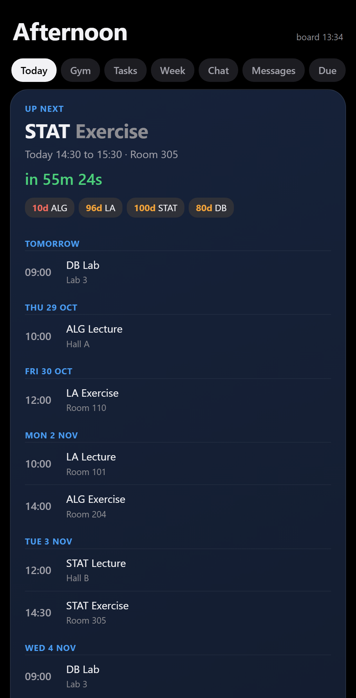

# iPhone setup

The board on your PC also lives on your iPhone: three lock screen widgets, home screen widgets and a full app with your
classes, tasks, gym coach and a chat with Claude. It keeps working while the PC is off.


*Screenshot with the built-in demo data (a fictional student, "Alex").*

The easiest way: open Claude Code in the board folder and say **"set up the iPhone part"**. Claude follows this page,
asks for your iPhone model, and does every PC-side step for you. The steps on the phone itself are yours; Claude walks
you through them. Below is everything in full, so you can also do it by hand or check what Claude did.

## How it works

```
 PC board (Board.ps1)  --git-->  your PRIVATE data repo on GitHub  <--GitHub API--  iPhone (Scriptable)
   writes phone.json             phone.json, digest, gym log ...      reads it, shows widgets and the app
   applies notes from inbox/     ask/  (taps and chat from the phone)  writes ask/ notes when you tap or chat
                                 GitHub Actions: phone/cloud-answer.mjs answers ask/ notes, PC on or off
```

- **Your data never goes into the public repo.** It goes into a second, private repository that only you can read.
- The phone reads the app code (`phone/widget.js`) from the public repo, so updates arrive on their own.
- Taps (tick a task, start the gym, ignore a task) are applied in the cloud without Claude: **no Claude usage**.
  Only chat messages (the normal chat and the gym coach) use Claude, on your own subscription.

## What you need

| | |
|---|---|
| iPhone | iOS 17 or newer (lock screen widgets need iOS 16 or newer) |
| [Scriptable](https://scriptable.app) | free app from the App Store, runs the widgets and the app |
| GitHub account | free; holds your private data repo |
| The board on your PC | set up with `SETUP-WITH-CLAUDE.md`, with Git installed |
| Claude subscription | only for the chat in the cloud (`claude setup-token`) |

## Step 1. Your private data repo (on the PC)

1. On github.com: **New repository**, name it for example `board-data`, set it to **Private**, tick
   "Add a README". Create it.
2. Clone it next to the board, for example to `%USERPROFILE%\board-data`:
   `git clone https://github.com/<you>/board-data "%USERPROFILE%\board-data"`
3. Copy two files from this repo into it:
   - `phone\cloud-answer.mjs` to `board-data\phone\cloud-answer.mjs`
   - `phone\workflow-phone.yml` to `board-data\.github\workflows\phone.yml`
   In `phone.yml` set `TZ:` to your time zone (the same as `city.timezone` in your `config.json`).
4. Optional: a short `board-data\about-me.md` (your goals, body weight for calorie estimates, coach tone). The cloud chat
   reads it. Nothing else about you is read in the cloud.
5. Commit and push: `git -C "%USERPROFILE%\board-data" add -A`, `git commit -m setup`, `git push`.
6. Tell the board about it in `config.json`:
   ```json
   "phone": { "repo_dir": "%USERPROFILE%\\board-data", "model": "iPhone 15 Pro Max", "platform": "iphone" }
   ```
   `model` must match a name in `phone\devices.json` (it sizes the lock screen widgets for your screen). Not listed? Leave
   it empty: the widgets then size themselves from the screen width.
7. Restart the board. Every 2 minutes it now writes `phone.json` into that folder and syncs it with git. Check after a few
   minutes that `phone.json` shows up in the repo on github.com.

## Step 2. A token for the phone

The phone reads and writes your data repo with a **fine-grained personal access token**, limited to that one repo.

1. github.com, your picture, **Settings**, **Developer settings**, **Personal access tokens**, **Fine-grained tokens**,
   **Generate new token**.
2. Name: `widget board phone`. Expiration: what you like (when it expires, the phone asks for a new one).
3. **Repository access: Only select repositories**, pick `board-data` and nothing else.
4. **Permissions, Repository permissions, Contents: Read and write.** Nothing else (Metadata: read-only is added automatically).
5. Generate it and copy it (it starts with `github_pat_`). You see it only once. Do not paste it into a chat or a file:
   it goes straight into the phone in step 3.

## Step 3. The app on the iPhone

1. Install **Scriptable** from the App Store and open it once.
2. Tap **+** for a new script. Name it **Widget Board** (tap the title at the top).
3. Paste the whole content of [`phone/loader.js`](phone/loader.js) (open it on github.com, tap **Raw**, select all, copy).
   It is about 40 lines; it loads the real app from this repo every time, so you never paste again.
4. Tap **Done**, then tap the script to run it. It asks for:
   - your data repo as `owner/name`, for example `you/board-data`
   - the token from step 2
   Both are stored in the iPhone's Keychain, not in the script.
5. The app opens: Today, Gym (with a tappable body map), Tasks, Week, Chat, Messages, Due, Exams. Tap things: tasks
   have Done / Later tonight / Tomorrow / Ignore / I don't know; the Gym page has a day picker and a session timer.



## Step 4. Lock screen widgets

Long-press the lock screen, **Customize**, **Lock Screen**, tap the widget area under the clock (and the line above it).

| Where | Widget | Parameter | Shows |
|---|---|---|---|
| Line above the clock | Scriptable (inline), script **Widget Board** | empty | Next class with a countdown and that day's start hours: `ALG in 21h · 3× 10,12,14` |
| Left rectangle | Scriptable (rectangular), script **Widget Board** | empty | Per course: tasks ticked this week, days to the next test or submission, days to the exam, and a ring counting down to the next one |
| Right rectangle | Scriptable (rectangular), script **Widget Board** | `day` | Changes with the time of day: next class or free time, the suggested gym day and its exercises (a timer while you train), the weather |

To set a widget's script and Parameter: tap the widget once while customizing, choose **Script: Widget Board**, type the
Parameter. The rectangles take two slots each, so both fit next to each other.

Home screen widgets (small, medium, large) work too; their Parameter picks the page: `today`, `gym`, `body`, `tasks`,
`week`, `messages`, `due` (empty = today).

## Step 5. Chat with Claude while the PC is off (optional)

Taps already work without this step. For the chat and the gym coach in the cloud:

1. On the PC, in a terminal: `claude setup-token`. Sign in; it prints a long token starting with `sk-ant-oat01-`.
2. github.com, your `board-data` repo, **Settings**, **Secrets and variables**, **Actions**, **New repository secret**.
   Name: `CLAUDE_CODE_OAUTH_TOKEN`. Value: that token. Save. Do not paste it anywhere else.
3. Send a chat message from the phone. After about a minute the reply appears (the **Actions** tab of the repo shows each run).

Each chat message is one short Claude run on your subscription. Taps never use Claude.

## Troubleshooting

| What you see | What to do |
|---|---|
| The lock screen still shows an old version after an update | iOS redraws lock screen widgets on its own schedule (roughly every 15 minutes). Open Widget Board in Scriptable once, then lock the phone. If it is still old: Customize, tap the widget, change its Parameter and change it back; that makes iOS run it fresh. Removing and re-adding a widget often only shows the last saved picture. |
| "Widget Board error ..." on a widget | The widget now shows its error instead of an old picture. Send that line to Claude in the board folder. |
| "No data yet" | The board has not pushed `phone.json` yet. Check `phone.repo_dir` in `config.json`, that the folder is a git clone, and that `git push` works there without asking for a password. |
| "Open Widget Board once to set it up" | Run the script in the Scriptable app; it asks for the repo and token. |
| Taps or chat do nothing | The token needs **Contents: Read and write** on the data repo. A wrong or expired token: run the app, it asks again. For chat, check the `CLAUDE_CODE_OAUTH_TOKEN` secret and the repo's Actions tab. |
| Widgets look cramped or too wide | Set `phone.model` in `config.json` to your model from `phone\devices.json`. |
| Weather missing | `city.lat` and `city.lon` in `config.json`. |
| Times are an hour off in chat replies | `TZ:` in `.github/workflows/phone.yml` of the data repo. |

## Privacy

- The public repo holds only code. Your data lives in the private data repo, the board folder on your PC, and Scriptable's
  folder on the phone.
- The token is limited to the data repo and stored in the Keychain. The cloud chat reads only the data repo
  (`phone.json`, the gym log, `about-me.md` if you add it) and never edits files; changes come back as notes.
- Mail features stay read-only; nothing is ever sent.
