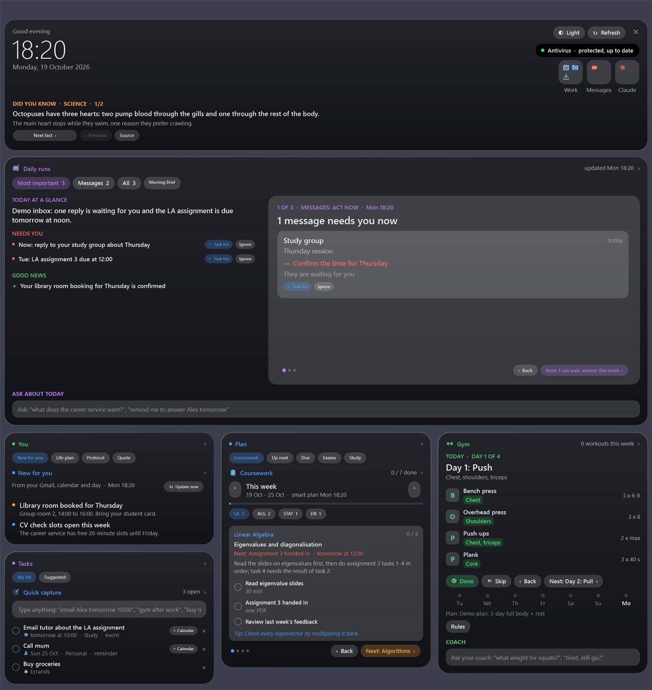
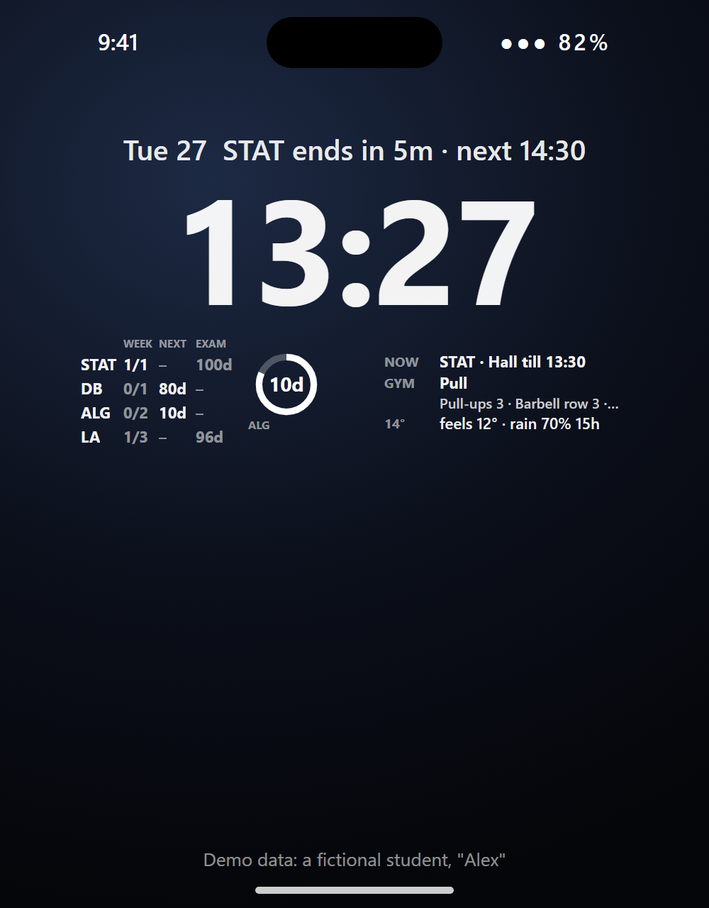
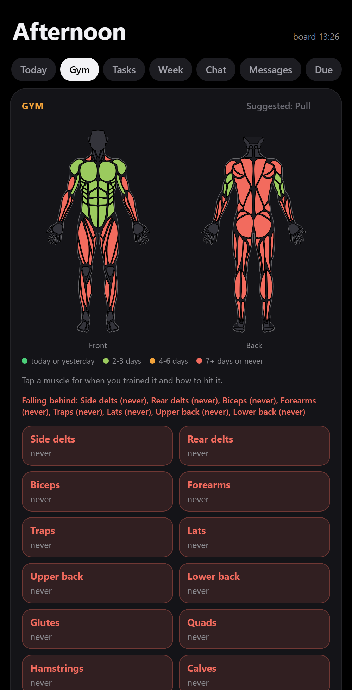
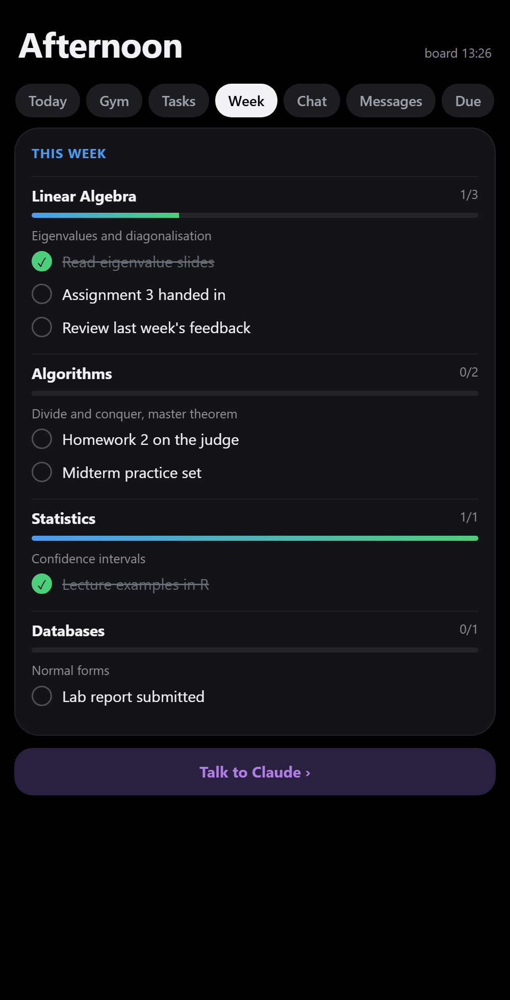
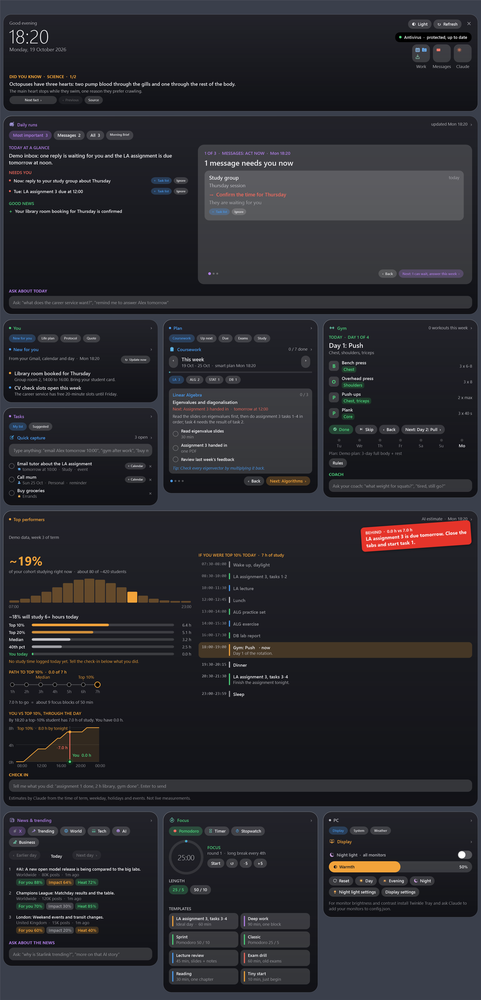
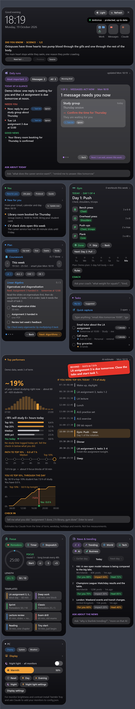

# Widget Board for Windows, iPhone and Android, set up and run by Claude

A widget board tailored to your life. On Windows, a small pill sits at the top of your screen; click it (or drag it down)
and a board of cards slides out. On your phone, the same day lives on the lock screen and in an app. It shows what is next today, your deadlines and exams, a gym plan with a coach, your inbox,
a progress tracker against the top 10% of your peers, news and trends, the weather, a focus timer and more. Many cards
are filled by Claude (Claude Code) in the background, and you can change anything just by telling Claude.



<p align="center"></p>
<p align="center"><em>The same day on your lock screen: countdown above the clock, courses and exams on the left, class, gym and weather on the right.</em></p>

**[Watch the 26-second video](media/widget-board-explainer.mp4)**: the board, the lock screen and home screen widgets, and how Claude sets it up.

*All screenshots use the built-in demo data (a fictional student, "Alex").*

## On your phone

| iPhone lock screen | The app: Gym | The app: Week |
|---|---|---|
|  |  |  |

- **iPhone** (free app [Scriptable](https://scriptable.app)): a countdown line above the clock, a left widget with your
  courses (tasks ticked this week, days to the next test and to the exam, a countdown ring) and a right widget that changes
  with the time of day (next class or free time, today's gym day and exercises, the weather), sized for your iPhone model.
  See [IPHONE-SETUP.md](IPHONE-SETUP.md).
- **Android**: the same app as an installable web app, plus optional home screen widgets through KWGT and Tasker. Lock
  screen widgets depend on your phone and Android version. See [ANDROID-SETUP.md](ANDROID-SETUP.md).
- **The app** (both): Today, Gym with a tappable body map (each muscle colored by days since you trained it), Tasks, Week
  (Done / Later tonight / Tomorrow / Ignore / I don't know on every task), Chat with Claude, Messages, Due and Exams.
- **Your data stays private**: the phone reads it from a second, *private* GitHub repo of yours. Taps work while the PC is
  off and use no Claude; chat messages are answered by Claude in GitHub Actions on your own subscription.

## Install: give this link to Claude

You need Windows 10 or 11 and [Claude Code](https://claude.com/claude-code) signed in. Open Claude Code in any folder and paste:

```
Set up this widget board for me: https://github.com/samzeidi/widget-board
Follow SETUP-WITH-CLAUDE.md in the repo.
```

Claude will:
1. Clone the board and show you the demo, and ask whether you have an iPhone or an Android phone (and which model).
2. Give you a list of every feature with its recommendation: what to set up for you and what to leave out.
3. Ask a few short questions (what you do, your city, timetable, exams, your gym goal and equipment, what news you like).
4. Write your own files: settings, timetable, deadlines, a gym plan made for you, a life plan, a study folder if you want one.
5. Turn on the background jobs you picked (facts, quote of the day, trends, daily inbox digest, coursework plan, ideal day).
6. Start the board at sign-in (Ctrl+Alt+W opens and closes it) and check that it works.
7. If you want the phone part: create your private data repo with you and walk you through the steps on the phone.

Want to look first? `powershell -ExecutionPolicy Bypass -STA -File Board.ps1 -Demo -Show` opens it with the sample data.

## How it works

- **The island.** The black pill at the top of the screen shows the clock and what is next (your next class, a deadline,
  the running timer). Click it or drag it down to open the board, drag it up or press Esc to close it. Drag it sideways to
  park it anywhere; it snaps to corners and edges and tucks itself away. Right-click: Refresh or Quit.
- **Cards.** Click a card's title (or anywhere on it) and a detail sheet slides up. Related cards are tabs of one card:
  *You* (New for you, Life plan, Daily protocol, Quote), *Plan* (Coursework, Up next, Due, Exams, Study),
  *Tasks* (Quick capture, Suggested work) and *PC* (Display, System, Weather).
- **Talk to it.** Quick capture turns "email Alex tomorrow 10:00" into a dated task with a "+ Calendar" button. The Gym
  coach, the Top performers check-in, Daily runs and News each have a small chat. Anything you tell one of them
  ("did legs, 2 h library") updates the whole board: the gym rotation, your study hours, your to-dos.
- **Claude in the background.** Jobs in `jobs\*.md` run with your Claude Code CLI at the times you choose (or as Claude
  cloud routines) and write small JSON files the cards read. The System card shows each job and a "Run now" button.
- **Change anything by asking.** Open Claude Code in the board folder and say what you want: "add a deadline Friday 12:00",
  "make the news card smaller", "switch the quote to haiku with English translations". `CLAUDE.md` tells Claude how.
- **Your monitor.** On a portrait monitor you get a tall two-column board; on a landscape screen the board fills the
  width with 2 to 5 columns. With two monitors, the Left / Right pills move it.

<details>
<summary>The whole board, landscape and portrait</summary>





</details>

## The cards

| Card | What you see |
|---|---|
| Daily runs | Your inbox sorted into act now / can wait / FYI, plus the output of your Claude cloud routines, one page at a time |
| Up next, Due, Exams | Today's next event with a progress bar, countdowns to deadlines and exams (retake dates behind "Retake") |
| Coursework, Study | A weekly checklist per course written by Claude from your course folders; one tile per course folder |
| Gym | Today's workout from your rotating plan, Done / Skip, the last 7 days, strength progression, a coach chat |
| Top performers | A progress tracker: what a top-10% person in your cohort has done by now vs you, the path to a top-10% day, an ideal day plan, a check-in chat |
| Life plan | A progress tracker for your goals: one-time steps, daily and weekly habits, the six that matter most, key dates |
| New for you | A daily read-only look at your Gmail and calendar for things that changed |
| Quick capture, Suggested work | Your task list (sorted by Claude) and ideas for what to do next |
| Focus | Pomodoro, timer and stopwatch with templates |
| News & trending | X trends, Google Trends and RSS feeds, each headline scored for you (For you / Impact / Heat) |
| Did you know, Quote of the day, Daily protocol | Five verified facts a day, a quote picked for your day in any language, one science-based health habit |
| Weather, Display, System | Forecast, monitor brightness / contrast and night light, drives, RAM, CPU and antivirus status |

## Privacy

Everything personal stays on your PC: your settings, profile, timetable, gym log, chats and every file the jobs write are
listed in `.gitignore`. The phone part copies what the phone needs into a separate *private* repository that only you can
read; the token for it stays on your phone. The mail features are read-only (optional reply drafts are off by default; nothing is ever sent).
The board calls Claude through your own Claude Code CLI; there are no API keys in this repo.

## Files

| | |
|---|---|
| `Board.ps1` | The whole app (Windows PowerShell 5.1 + WPF, one file) |
| `SETUP-WITH-CLAUDE.md` | The setup guide Claude follows |
| `CLAUDE.md` | How Claude changes the board when you ask |
| `jobs\*.md` | Prompts of the background jobs |
| `examples\` | The shapes of the data files |
| `tools\` | Autostart, night light, demo data, optional icon generators |
| `ui-icons\`, `gym-icons\` | Icons |

Flags: `-Show` opens the board at start, `-Demo` uses the sample data, `-Snapshot <png>` renders it off-screen,
`-Layout portrait|landscape` forces a layout.
