# Set it up, step by step

About 15 minutes, on Windows 10 or 11. These pictures are illustrations of the steps, and what you see may look a little different.

## 1. Install your AI tool
Open **PowerShell** from the Start menu, then follow the card for your AI further down this page.

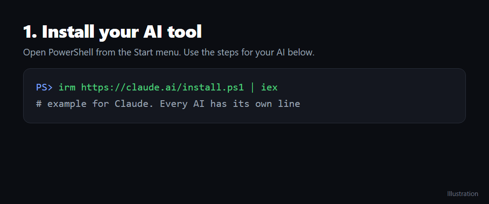

## 2. Paste one message
Start your AI tool and send it this:

```
Set up this widget board for me: https://github.com/samaistudio/widget-board
Follow SETUP.md in the repo.
```

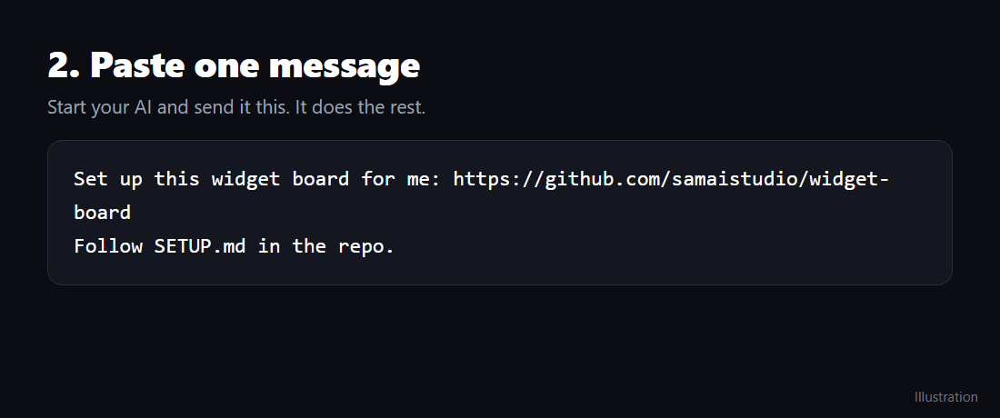

## 3. Tick every AI you pay for
It shows you the list. Tick as many as you like, and it picks the one that works best on your PC.

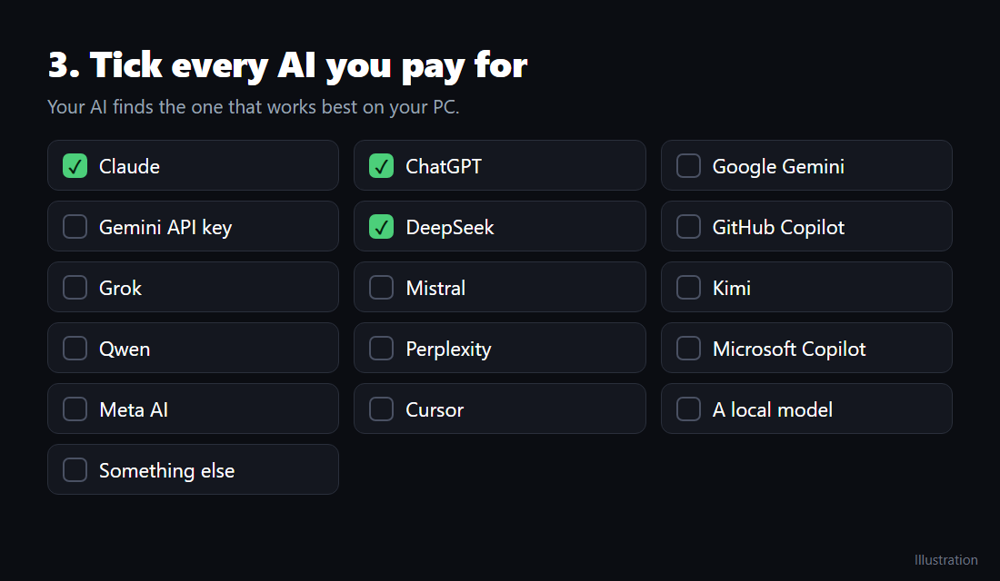

## 4. Tick the features you want
Tick some, or just say "all".

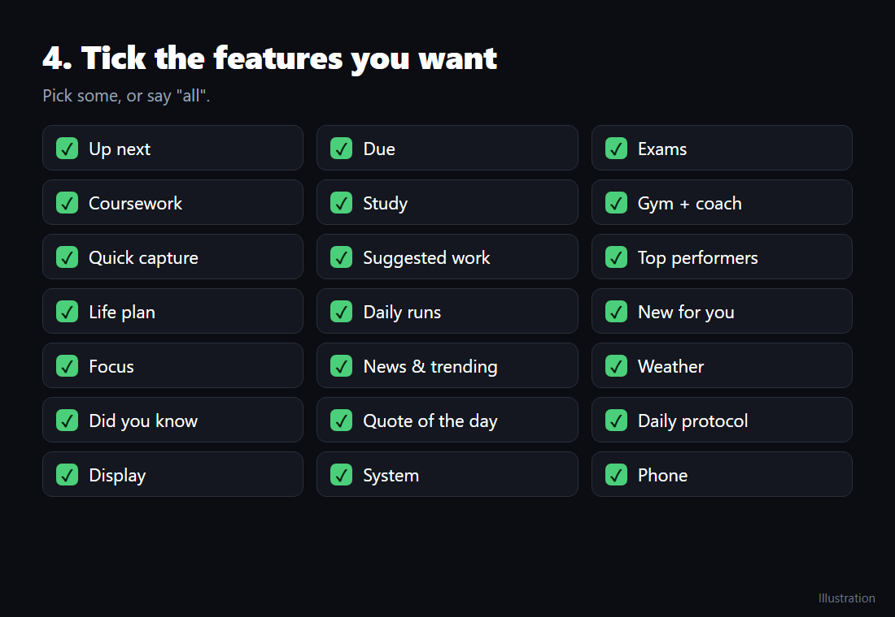

## 5. Answer a few questions
Every feature gets made for you, including a new workout plan. You type your own passwords and keys, and never paste them into the chat.

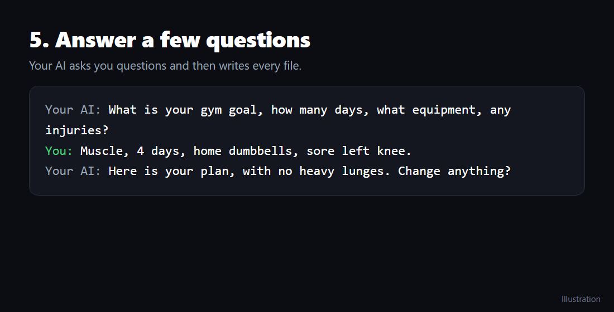

## 6. Done
The board starts when you sign in. Press **Ctrl+Alt+W** to open or close it. To change anything later, just tell your AI.

# Your AI

These tools change often. Each card links to the official page, so follow that page if it says something different. Only Claude Code has been tested end to end with this board; on other tools, your AI tests its own setup in step 3, and the two features that read your mail stay off.

## Claude
Pro, Max or Team. [Official page](https://code.claude.com/docs/en/quickstart)

```powershell
irm https://claude.ai/install.ps1 | iex
```

Sign in with your Claude account in the browser, then paste the message from step 2.

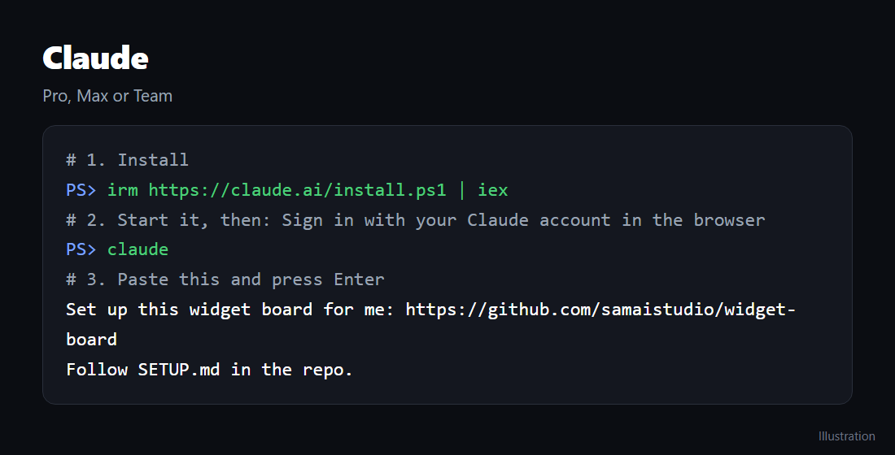

## ChatGPT
Plus, Pro or Team, through Codex. [Official page](https://github.com/openai/codex)

```powershell
npm install -g @openai/codex
```

Choose Sign in with ChatGPT, then paste the message from step 2.

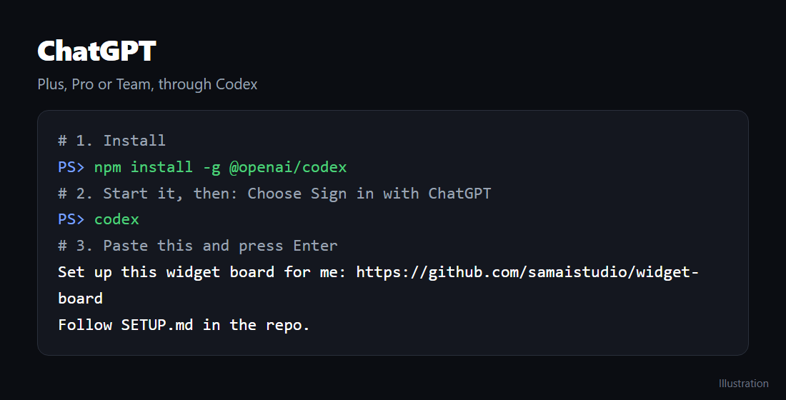

## Google Gemini
Google AI Pro or Ultra, through Antigravity. [Official page](https://antigravity.google)

Sign in with your Google account, then paste the message from step 2.

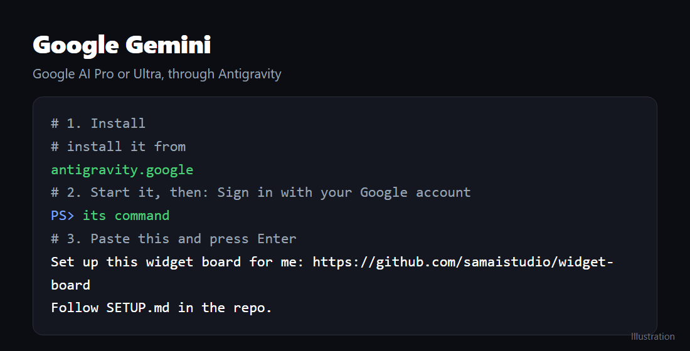

## Gemini API key
through Gemini CLI, paid per use. [Official page](https://github.com/google-gemini/gemini-cli)

Enter your API key where the tool asks, then paste the message from step 2.

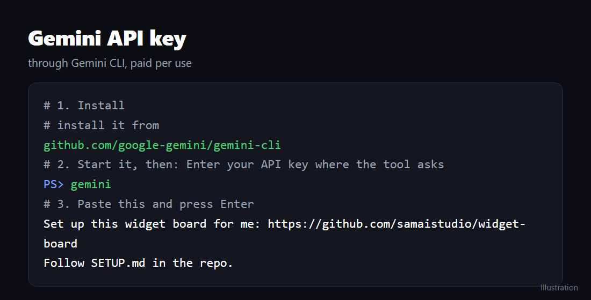

## GitHub Copilot
paid Copilot plan, through Copilot CLI. [Official page](https://github.com/github/copilot-cli)

Sign in with GitHub, then paste the message from step 2.

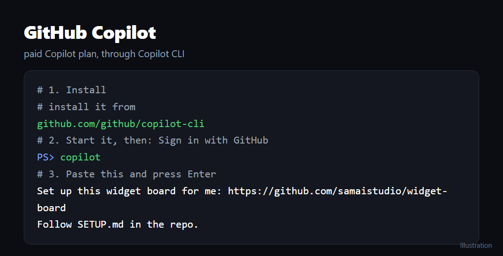

## Grok
SuperGrok or X Premium+, through Grok Build. [Official page](https://x.ai/cli)

Sign in with your account, then paste the message from step 2.

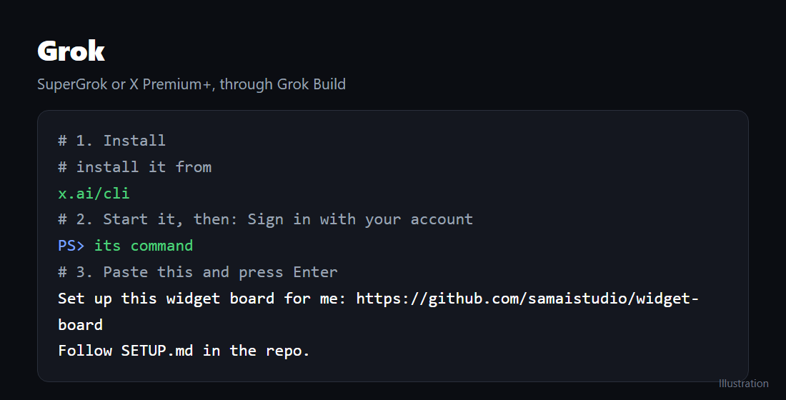

## Mistral
through Mistral Vibe. [Official page](https://github.com/mistralai/mistral-vibe)

Sign in or enter your API key, then paste the message from step 2.

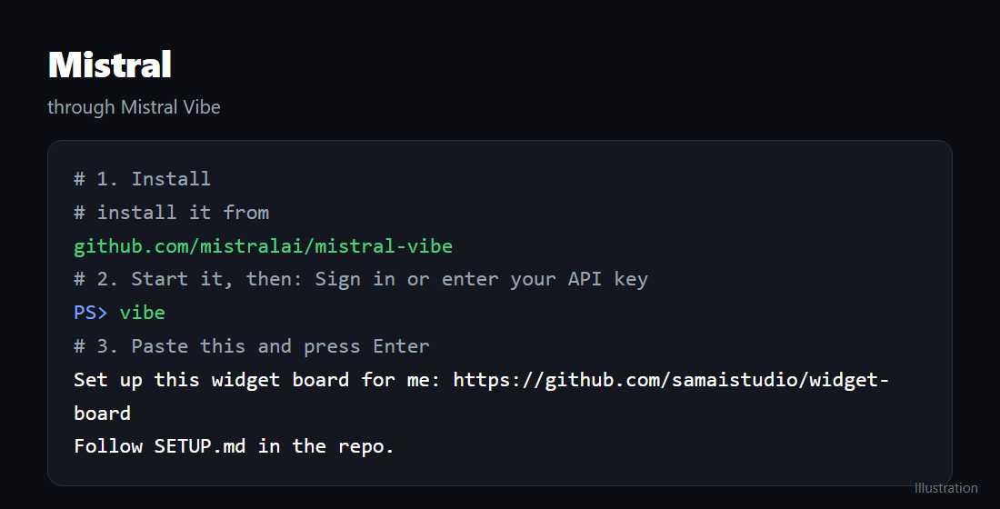

## DeepSeek
API key, paid per use, through OpenCode or Aider. [Official page](https://opencode.ai)

Choose DeepSeek and enter your API key, then paste the message from step 2.

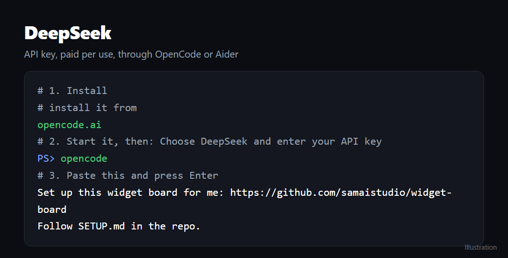

## Kimi
through Kimi CLI. [Official page](https://github.com/MoonshotAI/kimi-cli)

Sign in with your account, then paste the message from step 2.

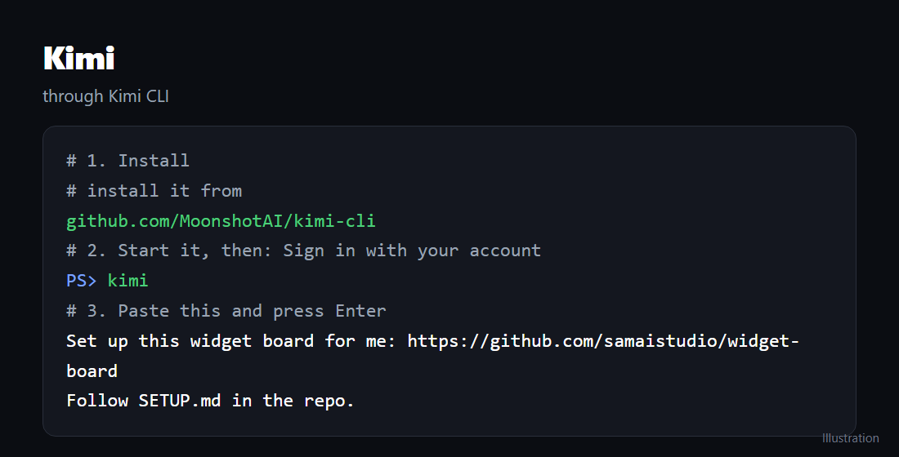

## Qwen
through Qwen Code. [Official page](https://github.com/QwenLM/qwen-code)

Sign in or enter your API key, then paste the message from step 2.

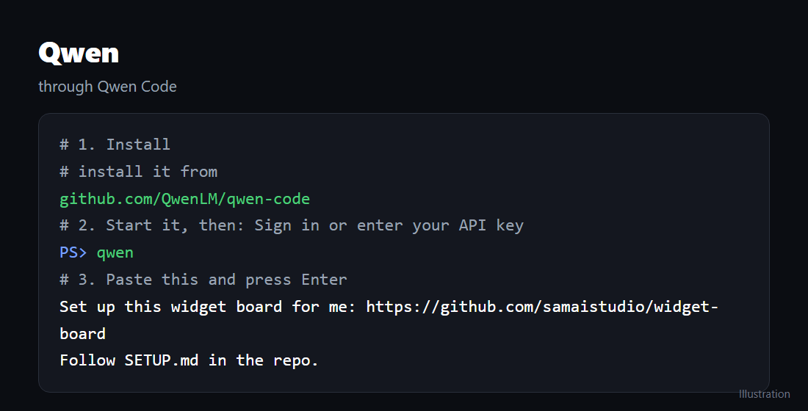

## Cursor
through Cursor CLI. [Official page](https://cursor.com/cli)

Sign in with your Cursor account, then paste the message from step 2.

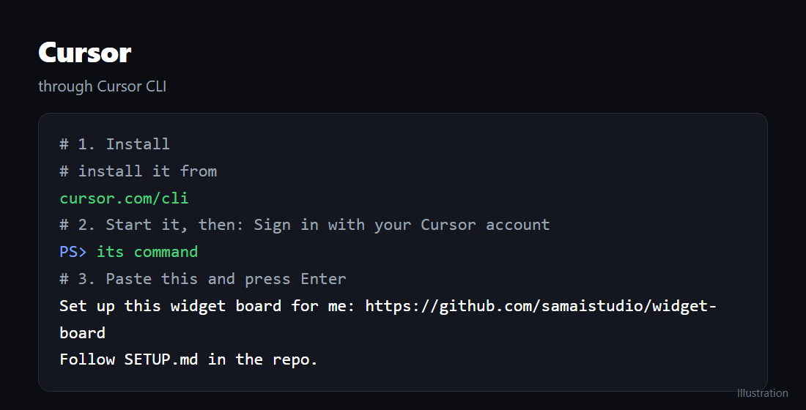

## A local model
free, runs on your PC, through Ollama plus OpenCode or Aider. [Official page](https://ollama.com)

No account. It needs a strong PC, then paste the message from step 2.

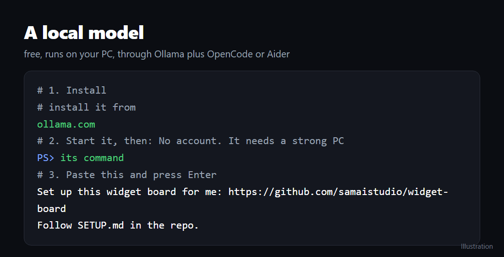

## Perplexity, Microsoft Copilot or Meta AI
We don't know of a tool that lets these run the board. You can still ask them questions about it, but use another AI from this page to set it up.

## No AI at all
The board still runs: clock, timer, weather, your own deadlines and your system stats. Cards written by AI stay empty.
